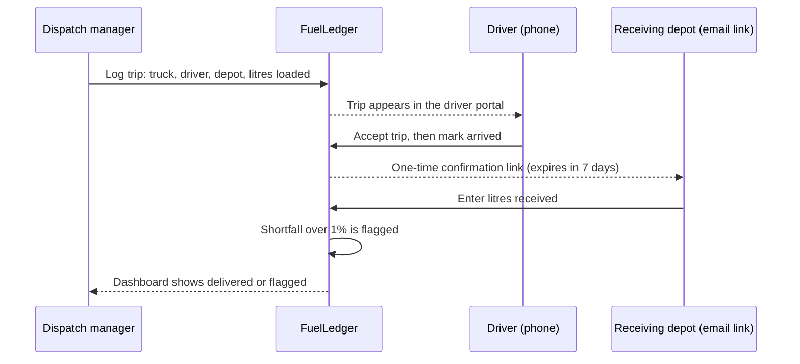
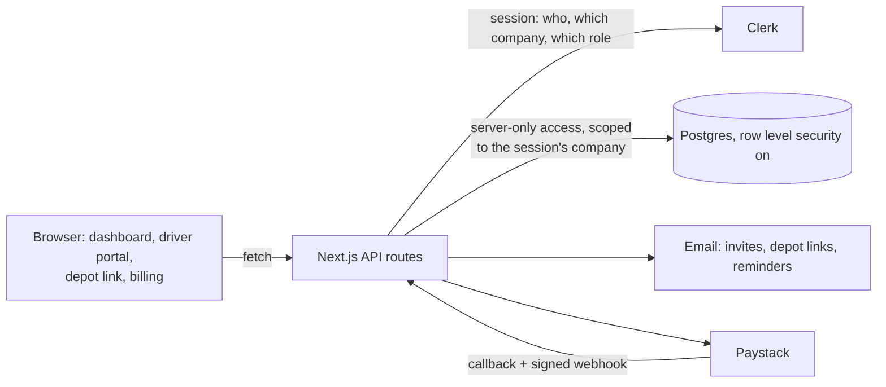

# FuelLedger

**A tamper-resistant record of every fuel delivery, from depot to destination.**

> The source code for this product is private because it is a commercial SaaS. This page describes what it does and how it is built. A live demo and code walkthrough are available on request.

FuelLedger is a web app for Kenyan fuel distributors and transporters. Each tanker trip is recorded by three different people, and none of them can change the others' entries:

1. **Dispatch manager:** logs the truck, driver, destination depot and litres loaded.
2. **Driver:** accepts the trip and marks arrival from their phone.
3. **Receiving depot:** gets a one-time link by email and enters the litres actually received, with no account needed.

If the depot receives more than 1% less than was loaded, the trip is flagged for investigation.

## The problem

Fuel goes missing between loading and delivery: siphoning on the road, short deliveries, and paperwork edited after the fact. Many distributors still track trips on paper delivery notes, spreadsheets or WhatsApp. Whoever holds the record can change it, so shortfalls surface weeks later, if at all. FuelLedger separates the records so that the comparison is done by the server, not by any one person.

## How a trip flows

## Features

- **Roles:** owners, admins, managers and drivers each see only what they need. Drivers see only their own trips and can move a trip forward one step at a time.
- **Depot confirmation:** a one-time link that expires after 7 days, so nobody at the dispatching company can confirm their own delivery.
- **Dashboard:** litres dispatched, delivered and flagged, with filters by date, driver and depot.
- **Paid plans in KES:**
  - 14-day free trial, then Basic and Pro plans through Paystack;
  - limits enforced on the server for managers, drivers and trips per month;
  - 30-day periods, and every payment applied exactly once;
  - expiry reminders by email.
- **Built for phones:** the driver portal and depot page are designed for use on the road.

## Architecture

## Built with

Next.js 16 · Clerk · Supabase (Postgres, RLS) · Paystack · Resend · Vitest

## Engineering highlights

- **No database access from the browser.** Every request works out the company and role from the signed-in session, never from anything the browser sends, so editing a URL or guessing an ID gets you nothing.
- **Decisions made on the server:** the discrepancy flag, the one-time token check and the plan limits.
- **Payments applied exactly once,** using a ledger table, even when Paystack's callback and webhook arrive together.
- **24 automated tests** and lint-clean code.

## Screenshots

_Coming soon: dashboard with flagged trips, the driver portal on a phone, the depot confirmation page, and billing._

## Contact

Built by Jesse Ngugi, Nairobi. [GitHub](https://github.com/ngugiauraa) · [Portfolio](https://ngugi.pages.dev)
